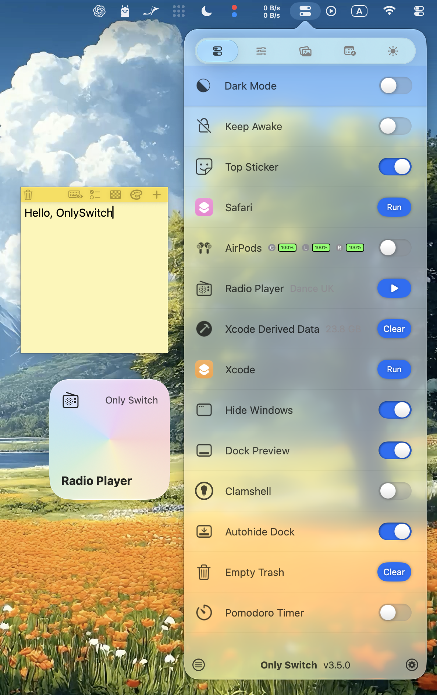
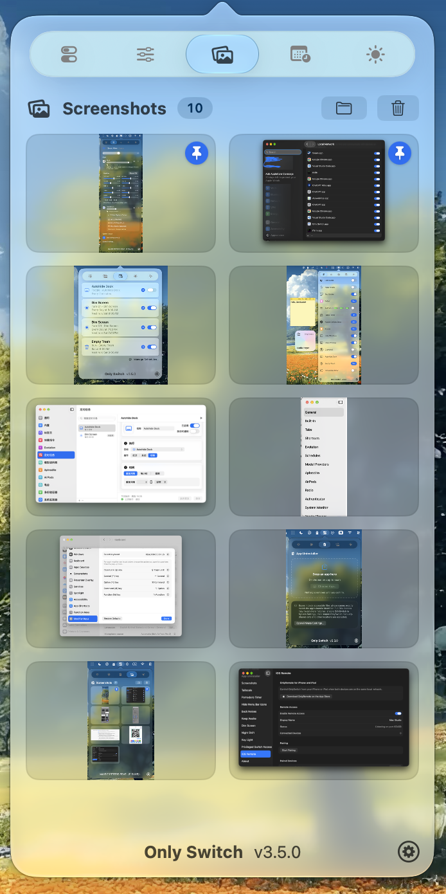
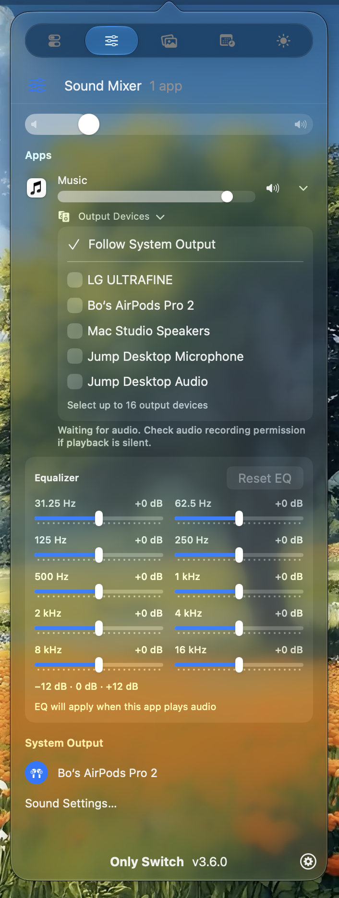
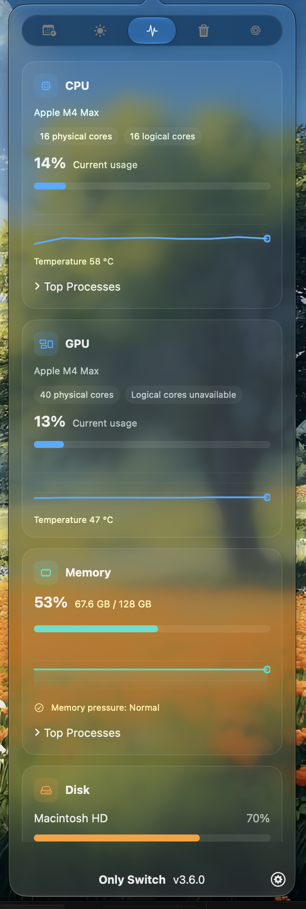
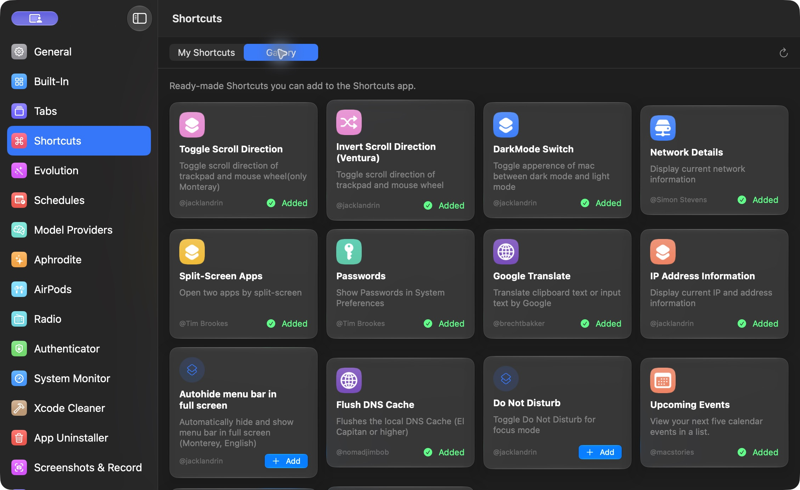
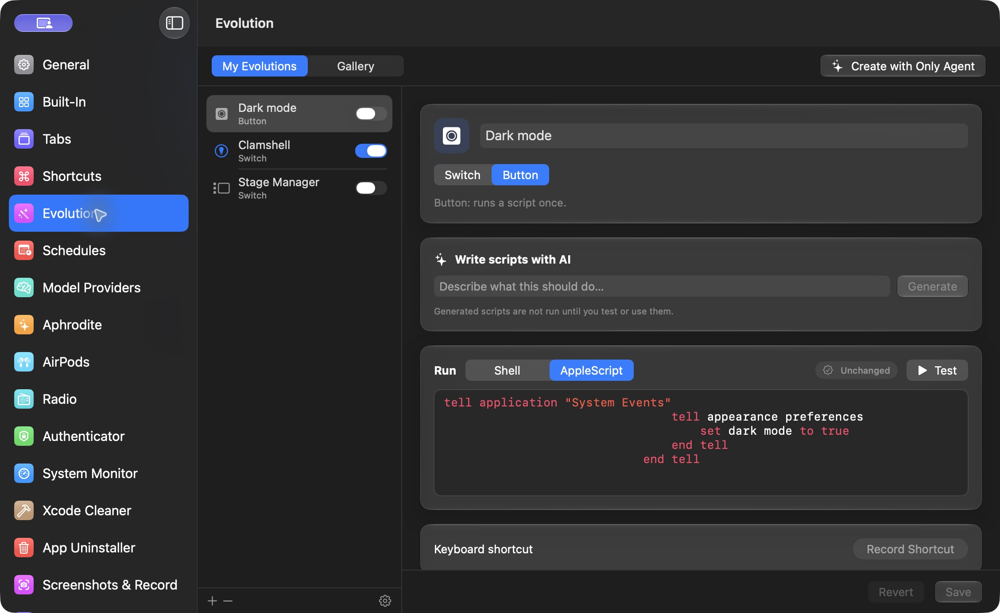
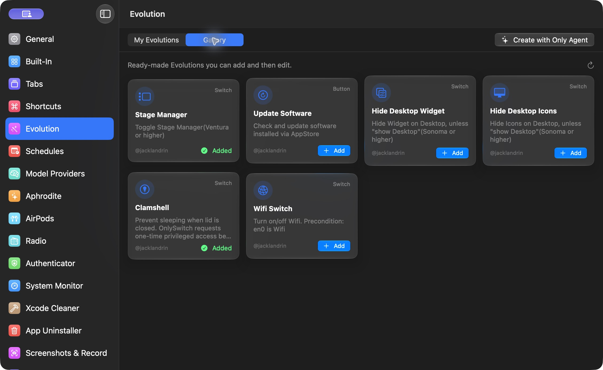
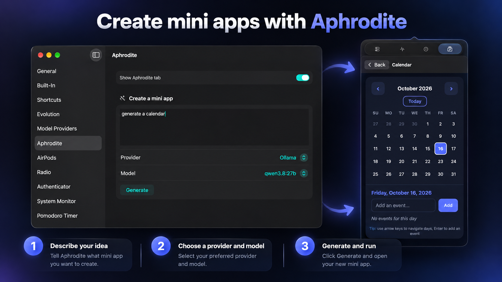
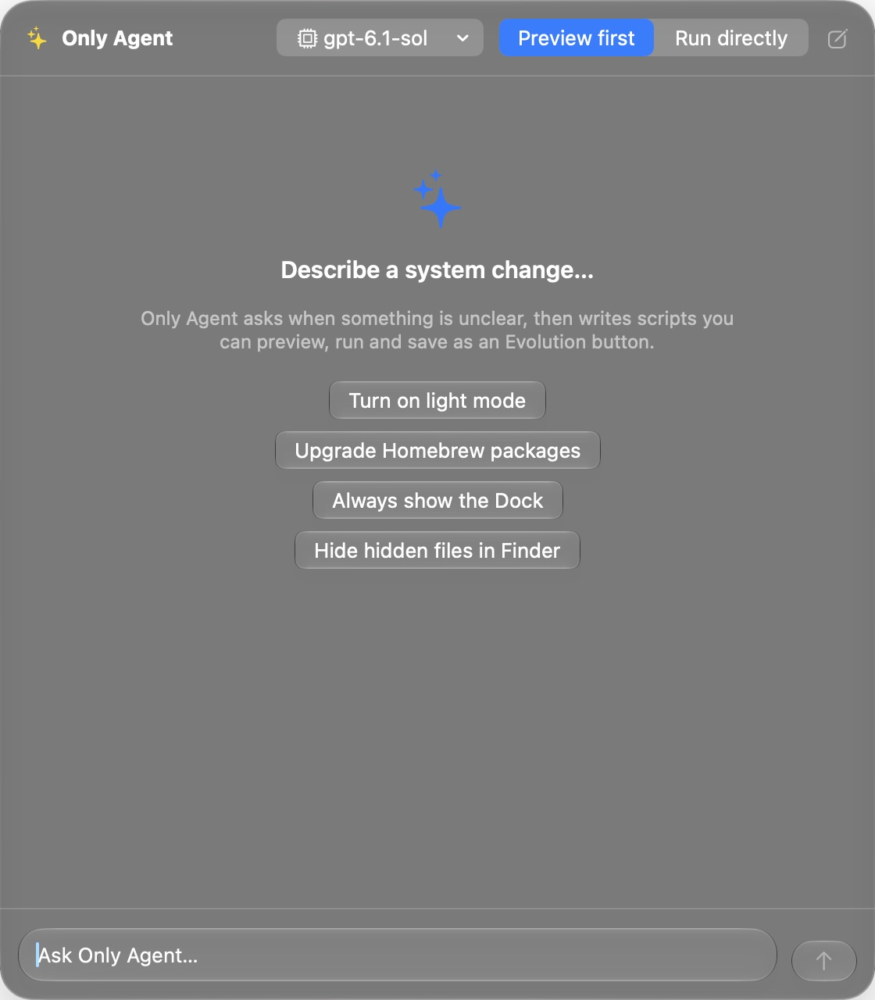

 
[](https://takoapi.com/agents/jacklandrin-onlyswitch)
 

<p align="center">
  <a href="https://onlyswitch.click">
    
  </a>
</p>

# OnlySwitch

[English](README.md) · **Deutsch** · [简体中文](README.zh-CN.md)

**Mehr Platz in der Menüleiste – mit einer App für deine Schalter.**

OnlySwitch bündelt alltägliche macOS-Funktionen in einer anpassbaren Menüleisten-App: Schreibtischsymbole ausblenden, das Erscheinungsbild ändern, den Mac wach halten oder die Displayaussparung verbergen. Du kannst Schalter und Kurzbefehle hinzufügen, entfernen und neu anordnen, Tastenkürzel zuweisen oder Bedienelemente als Widgets auf dem Schreibtisch platzieren.

<p align="center">
  
</p>

<table>
  <tr>
    <td valign="top" width="33%"></td>
    <td valign="top" width="33%"></td>
    <td valign="top" width="33%"></td>
  </tr>
</table>

## Installation

### Homebrew

```sh
brew install only-switch
```

### Manueller Download

[Aktuelles OnlySwitch-DMG herunterladen](https://github.com/jacklandrin/OnlySwitch/releases/latest/download/OnlySwitch.dmg).

> [!IMPORTANT]
> In Version 2.5.6 und älter funktioniert die automatische Aktualisierung nicht. Wenn du eine dieser Versionen verwendest, aktualisiere sie manuell oder installiere OnlySwitch erneut über Homebrew.

## Schnellstart

1. Starte OnlySwitch. Falls macOS das Symbol nicht anzeigt, aktiviere die App unter **Systemeinstellungen → Menüleiste**.
2. Klicke auf das OnlySwitch-Symbol in der Menüleiste, um die Liste der Bedienelemente zu öffnen.
3. In den Einstellungen kannst du Schalter und Kurzbefehle hinzufügen, entfernen und neu anordnen, Tastenkürzel festlegen und optionale Funktionen aktivieren.
4. Füge auf unterstützten macOS-Versionen Only Widget aus der Widget-Galerie hinzu, um vom Schreibtisch oder von der Mitteilungszentrale darauf zuzugreifen.

Um OnlySwitch vom iPhone oder iPad aus zu steuern, installiere [OnlyRemote aus dem App Store](https://apps.apple.com/us/app/onlyremote/id6793657946). Öffne anschließend **iOS-Fernbedienung** in den OnlySwitch-Einstellungen, erlaube den Zugriff über das lokale Netzwerk und kopple das Gerät.

<p align="center">
  
</p>

<p align="center">
  
</p>

## Funktionen

### Auf einen Blick

- Automatisiere wiederkehrende Mac-Aufgaben mit [Zeitplänen](#zeitpläne).
- Importiere macOS-Kurzbefehle in OnlySwitch und bediene Schalter und Kurzbefehle mit Tastenkürzeln.
- Wähle aus, welche Bedienelemente angezeigt werden, und ordne sie passend zu deinem Arbeitsablauf an. Integrierte Schalter sind nach Kategorien gruppiert und lassen sich nach Namen suchen.
- Verwalte optionale Seiten zentral: Unter **OnlySwitch-Einstellungen → Tabs** blendest du Tabs in der Menüleistenliste und in Only Control ein oder aus.
- Verwende Apple-Widgets ab macOS Sonoma, auch mit Bedienelementen aus Evolution.
- Öffne **Only Control**, um die wichtigsten Bedienelemente in einer kompakten Ansicht zu nutzen.
- Steuere deinen Mac mit [OnlyRemote](#onlyremote) vom iPhone oder iPad aus.
- Aktiviere das optionale Schreibtisch-Haustier und ziehe es an eine beliebige Position. Per Klick öffnest oder schließt du Only Control. Wechsle zum nächsten Titel oder Radiosender und sieh Wiedergabeanimationen für Apple Music, Spotify und Radio.
- Aktiviere bei **Wach bleiben** die Option **Nach Ruhezustand ausschalten**, damit die Funktion deaktiviert wird, wenn du den Mac manuell in den Ruhezustand versetzt.

<p align="center">
  
</p>

<p align="center">
  
</p>

### Zeitpläne

Öffne **OnlySwitch-Einstellungen → Zeitpläne**, um unterstützte Schalter, Tasten, Kurzbefehle und Evolutions zu automatisieren. Aktionen können in festen Abständen, zu einer bestimmten Minute jeder Stunde oder zu einer festen Uhrzeit an ausgewählten Tagen ausgeführt werden. Dimme etwa täglich um 8:00 Uhr den Bildschirm und hebe die Dimmung um 19:00 Uhr wieder auf. Oder leere jeden Samstag um 9:00 Uhr den Papierkorb.

Im Tab **Zeitpläne** in der Menüleistenliste oder in Only Control siehst du, welche Aktion als Nächstes ansteht. Du kannst sie sofort ausführen oder einen Zeitplan ein- und ausschalten. Den Tab blendest du unter **OnlySwitch-Einstellungen → Tabs** ein oder aus. Zeitpläne werden lokal ausgeführt, solange OnlySwitch läuft, auch wenn kein Fenster geöffnet ist.

### Integrierte Schalter

| Schalter | Status | Schalter | Status |
|:---|:---|:---|:---|
| Schreibtisch ausblenden | Verfügbar | Displayaussparung verbergen | Bekannte Probleme |
| Dunkelmodus | Verfügbar | Stromsparmodus | Einmalige Autorisierung erforderlich |
| Bildschirmschoner | Verfügbar | Pfadleiste im Finder anzeigen | Verfügbar |
| Night Shift | Verfügbar | Mikrofon stummschalten | Verfügbar |
| Dock automatisch ausblenden | Verfügbar | Kleine Launchpad-Symbole | Verfügbar |
| AirPods | Verfügbar | Pomodoro-Timer | Verfügbar |
| Bluetooth | Verfügbar | Dateinamenerweiterungen anzeigen | Verfügbar |
| Xcode-Cache | Verfügbar | Benutzer-Library anzeigen | Verfügbar |
| Menüleiste automatisch ausblenden | Verfügbar | Ton stummschalten | Verfügbar |
| Versteckte Dateien anzeigen | Verfügbar | Zwischenablage leeren | Verfügbar |
| Radiosender | Verfügbar | Papierkorb leeren | Verfügbar |
| Wach bleiben | Verfügbar | Zuletzt verwendete Apps im Dock anzeigen | Verfügbar |
| Spotify | Verfügbar | Apple Music | Verfügbar |
| Bildschirmtest und Reinigung | Verfügbar | Menüleistensymbole ausblenden | Teilweise verfügbar |
| FKey | Verfügbar | Hintergrundgeräusche | Verfügbar |
| Bildschirm dimmen | Verfügbar | Datenträger auswerfen | Verfügbar |
| Fenster ausblenden | Teilweise verfügbar | True Tone | Verfügbar |
| Top Sticker | Teilweise verfügbar | Key Light | Verfügbar |
| Only Agent | Verfügbar | Natürliches Scrollen | Verfügbar |
| Schreibtisch-Haustier anzeigen | Verfügbar | Tailscale | Offizieller Client erforderlich |
| Dock-Fenstervorschau | Berechtigungen für Bedienungshilfen und Bildschirmaufnahme erforderlich | | |

Du kannst Schalter zur Liste hinzufügen oder daraus entfernen. Optionale Tabs wie Authenticator, Lautstärkemixer, Helligkeit, Bildschirmfotos & Aufnahmen, Systemmonitor, Codex-Nutzung, Claude-Nutzung, Aphrodite, Xcode Cleaner und App Uninstaller lassen sich unter **OnlySwitch-Einstellungen → Tabs** ein- und ausblenden. Diese Seite ersetzt die früheren Schalter, die nur einen Tab ein- oder ausgeblendet haben.

### Lautstärkemixer

Der Lautstärkemixer regelt die Lautstärke und Stummschaltung für jede App, die Audio wiedergibt. Ab macOS 14.4 kannst du pro App zusätzlich einen 10-Band-Equalizer öffnen (−12 bis +12 dB, mit Rücksetzen auf eine neutrale Einstellung) und den Ton gleichzeitig an eines oder mehrere Ausgabegeräte senden. OnlySwitch merkt sich den Equalizer und die Ausgabegeräte pro App. Ohne Auswahl gilt die Systemvorgabe. Wenn alle ausgewählten Geräte getrennt werden, wird die ursprüngliche Audioausgabe der App wiederhergestellt, bis eines dieser Geräte erneut verfügbar ist.

Wenn der Ton über ein externes Display mit Lautsprechern ausgegeben wird, regeln die Tasten für lauter, leiser und stumm die Displaylautstärke über DDC/CI. Dabei erscheint eine Lautstärkeanzeige. Mit gedrückter Umschalt- und Wahltaste erfolgt die Regelung in kleineren Schritten. Zum Abfangen dieser Tasten ist die Berechtigung für Bedienungshilfen nötig.

### Helligkeit

Der Tab **Helligkeit** zeigt für jedes aktive Display einen Regler. OnlySwitch verwendet bei Apple-Displays die systemeigene Helligkeitsregelung, bei kompatiblen externen Monitoren DDC/CI und ohne Hardwaresteuerung eine softwarebasierte Abdunklung. In jeder Zeile steht, welche Methode verwendet wird. Unter **OnlySwitch-Einstellungen → Display** findest du weiche Übergänge, kombinierte Hardware- und Softwaredimmung für einen besonders dunklen Bereich, die Synchronisierung mit dem integrierten Display und die Option, die Softwarehelligkeit auf null zu stellen.

Die Helligkeitstasten regeln das externe Display unter dem Mauszeiger. Für kleinere Schritte gilt dieselbe Tastenkombination wie bei der Lautstärke. Beim integrierten Display bleibt das Verhalten von macOS unverändert. Die Softwaredimmung verändert die Bildhelligkeit, nicht die Hintergrundbeleuchtung.

### Bildschirmfotos & Aufnahmen

Dieser Tab sammelt Bildschirmfotos und Bildschirmaufnahmen in einer Liste. Aktiviere **Bildschirmfotos & Aufnahmen sammeln** unter **OnlySwitch-Einstellungen → Bildschirmfotos & Aufnahmen**. Damit werden Systemaufnahmen, Videos mit ⇧⌘5 sowie Fotos und Videos aus dem iOS-Simulator und dem Xcode Device Hub in `~/Pictures/OnlySwitch Screenshots` gespeichert. OnlySwitch sichert deine bisherigen Aufnahmeeinstellungen und stellt sie wieder her, wenn du die Sammlung deaktivierst. Neue Aufnahmen werden automatisch mit einer Animation in die Liste eingefügt. Bei Videos erscheint dabei das erste Bild.

Klicke auf einen Eintrag, um ihn zu kopieren, oder öffne ihn per Doppelklick. Ziehe ihn zum Teilen aus der Liste oder hefte ihn oben an. Videos sind durch ein Symbol mit Laufzeit gekennzeichnet und werden als Dateien kopiert. Im integrierten Editor kannst du Bildschirmfotos mit Freihandstrichen, Rechtecken, Ellipsen, Pfeilen und Unschärfe versehen und Änderungen rückgängig machen oder wiederholen. Beim Speichern wird die Originaldatei im ursprünglichen Format überschrieben. Videos lassen sich nicht bearbeiten. Gelöschte Dateien landen im Papierkorb; **Alle löschen** lässt angeheftete Einträge stehen. In den Einstellungen dieser Funktion kannst du ein Tastenkürzel zum Öffnen und Schließen des Tabs festlegen. Aufnahmen, die nur in der Zwischenablage landen, werden nicht gesammelt.

### Dock-Fenstervorschau

Bewege den Mauszeiger über eine App im Dock, um Vorschaubilder ihrer geöffneten Fenster zu sehen. Per Klick auf ein Vorschaubild holst du das Fenster in den Vordergrund. Bei Apple Music und Spotify bietet die Vorschau außerdem Tasten für den vorherigen Titel, Wiedergabe oder Pause und den nächsten Titel. Aktiviere **Dock-Fenstervorschau** und erteile bei der Abfrage die Berechtigungen für Bedienungshilfen und Bildschirmaufnahme.

### Tailscale

Installiere und konfiguriere den offiziellen Tailscale-Client. Öffne dann **OnlySwitch-Einstellungen → Tailscale**, um gespeicherte Konten, Exit-Nodes und unterstützte Netzwerkoptionen zu verwalten. Der Schalter **Tailscale** verbindet oder trennt das aktive Konto. Besteht eine Verbindung, kannst du über den Untertitel die Tailscale-IP deines Macs kopieren.

### Xcode Cleaner

Öffne **OnlySwitch-Einstellungen → Xcode Cleaner**. Alternativ kannst du unter **Einstellungen → Tabs** den Tab für die Menüleistenliste oder Only Control einblenden. Lass die Entwicklungsdaten durchsuchen, prüfe die ausgewählten Einträge und bestätige die Bereinigung. Unterstützt werden DerivedData, Xcode- und SwiftPM-Caches, Simulator-Caches und -Protokolle, Simulatorgeräte und -Laufzeitumgebungen sowie DeviceSupport-Dateien. Quellcodeprojekte und Archive bleiben ausgeschlossen.

### App Uninstaller

Öffne **OnlySwitch-Einstellungen → App Uninstaller**. Alternativ kannst du unter **Einstellungen → Tabs** den Tab für die Menüleistenliste oder Only Control einblenden. Ziehe eine App in das Fenster oder wähle sie aus, prüfe die App und die dazu gefundenen Dateien und bestätige, welche Einträge in den Papierkorb verschoben werden sollen. Die Suche vergleicht die Bundle-ID an unterstützten Speicherorten und findet daher möglicherweise nicht alle zugehörigen Dateien.

Dock-Fenstervorschau, Tailscale, Xcode Cleaner und App Uninstaller sind lokale Mac-Funktionen und in Only Widget und OnlyRemote nicht verfügbar. Auch Bildschirmfotos & Aufnahmen werden in Only Widget nicht angeboten. Mit OnlyRemote Plus kannst du Bildschirmfotos anzeigen, kopieren, herausziehen und löschen sowie Videos abspielen, herausziehen und löschen. Eine Bearbeitung ist dort nicht möglich.

### Kurzbefehle-Galerie

Öffne **OnlySwitch-Einstellungen → Kurzbefehle → Galerie**, um fertige macOS-Kurzbefehle zu entdecken und zur Kurzbefehle-App hinzuzufügen. Unter **Meine Kurzbefehle** kannst du bis zu zehn für das OnlySwitch-Menü auswählen und Tastenkürzel zuweisen.

<p align="center">
  
</p>

Alle können macOS-Kurzbefehle beisteuern. Siehe [Anleitung zum Mitmachen bei der Kurzbefehle-Galerie](ShortcutsGalleryContributing.md).

| Kurzbefehl | Hinweis | Kurzbefehl | Hinweis |
|---|---|---|:---|
| Toggle Scroll Direction | Monterey | Invert Scroll Direction (Ventura) | Ventura |
| DarkMode Switch | | Network Details | |
| Split-Screen Apps | | Passwords | |
| Google Translate | | IP Address Information | |
| Autohide menu bar in full screen | Monterey | Flush DNS Cache | |
| Do Not Disturb | Ab Monterey | Upcoming Events | |
| S-GPT | Funktioniert mit S-GPT Encoder; erfordert einen OpenAI-API-Schlüssel | S-GPT Encoder | |

### Aktionen für Kurzbefehle

| Aktion | Status |
|---|---|
| Hintergrundbild abrufen | Bekannte Probleme |
| URL des Hintergrundbilds abrufen | Verfügbar |
| Dunkelmodus abfragen | Verfügbar |
| Dunkelmodus einstellen | Verfügbar |

### Evolution

Öffne **OnlySwitch-Einstellungen → Evolution → Meine Evolutions**, um eigene Schalter und Tasten mit Shell oder AppleScript zu erstellen. Wähle in der Seitenleiste eine Evolution aus, um ihre Skripte zu bearbeiten, zu testen und ein Tastenkürzel zuzuweisen. Ab macOS 26 kannst du bei eingerichtetem Only Agent beschreiben, was du erreichen möchtest, und dir einen Skriptentwurf zur Prüfung erstellen lassen.

Evolution-Skripte laufen lokal mit den Berechtigungen von OnlySwitch. Prüfe sie vor dem Speichern oder Importieren, insbesondere wenn sie Shell-Befehle, Apple Events oder Aktionen mit erhöhten Rechten ausführen.

<p align="center">
  
</p>

Wechsle zur **Galerie**, um fertige Evolutions zu entdecken. Über **Hinzufügen** übernimmst du eine Evolution in **Meine Evolutions**, wo du sie prüfen und bearbeiten kannst. Alle können eine Evolution beisteuern. Siehe [Anleitung zum Mitmachen bei der Evolution-Galerie](EvolutionGalleryContributing.md).

<p align="center">
  
</p>

| Evolution | Hinweis | Evolution | Hinweis |
|---|---|---|:---|
| Stage Manager | | Update Software | Über den App Store installiert |
| Hide desktop Widget | Sonoma | Hide Desktop Icons | Sonoma |
| Clamshell | | Wi-Fi Switch | |

#### Eine Evolution erstellen

Evolution unterstützt zwei Typen:

1. Eine **Taste** führt ihr Skript aus, wenn du auf **Ausführen** klickst.
2. Ein **Schalter** hat vier bearbeitbare Felder:
   - **Status überprüfen:** Wird ausgeführt, wenn die OnlySwitch-Liste erscheint oder sich Einstellungen ändern. Die Debug-Taste zeigt die Skriptausgabe.
   - **Bedingung für „Ein“:** Legt fest, welche Ausgabe den eingeschalteten Zustand kennzeichnet.
   - **Einschalten:** Schaltet die Funktion ein.
   - **Ausschalten:** Schaltet die Funktion aus.

Verwende vor dem Speichern **Testen** für jedes neue oder geänderte Skript unter **Ausführen**, **Einschalten** oder **Ausschalten**.

### Aphrodite

Aphrodite erstellt Mini-Apps aus natürlichsprachlichen Beschreibungen. Beschreibe, was du möchtest, und wähle einen eingerichteten KI-Anbieter und ein Modell. Anschließend kannst du das Ergebnis erzeugen, ausführen, bearbeiten, speichern, teilen oder importieren. Aphrodite benötigt macOS 26 oder neuer und verwendet die in OnlySwitch konfigurierten Modellanbieter.

<p align="center">
  
</p>

### Only Agent und OpenClaw

Only Agent ist ein Dialogassistent für macOS 26 oder neuer. Wähle ein Modell und beschreibe die gewünschte Änderung. Only Agent kann Rückfragen stellen und Shell- oder AppleScript-Skripte entwerfen, die du ausführen oder als Evolution-Taste speichern kannst. Mit **Erst Vorschau** (Preview first) siehst du das Skript vor der Ausführung; **Direkt ausführen** (Run directly) startet es sofort. Wenn du ein gehostetes Modell auswählst, kann deine Anfrage an dessen Anbieter gesendet werden.

<p align="center">
  
</p>

Du kannst OnlySwitch auch über [OpenClaw](https://openclaw.ai/) in natürlicher Sprache steuern. Sage zum Beispiel *„Papierkorb leeren“*, *„Wach halten umschalten“* oder *„Dunkelmodus einschalten“*, um den passenden Schalter per Deeplink auszulösen. Die [OpenClaw-Einrichtung](OpenClaw/README.md) beschreibt die Installation als zusätzliches Skill-Verzeichnis oder unter `~/.openclaw/skills`.

### Systemmonitor

Der Systemmonitor zeigt live die Auslastung von CPU, GPU, Arbeitsspeicher, Datenträgern und Netzwerk. Öffne den Tab in Only Control und wähle unter **OnlySwitch-Einstellungen → Systemmonitor** die gewünschten Karten und optionalen Menüleistenanzeigen. Die Karten für CPU und Arbeitsspeicher lassen sich aufklappen, um die Prozesse mit der höchsten Auslastung zu sehen. Netzwerkdetails zeigen WLAN- oder Ethernet-Informationen, lokale und öffentliche IP-Adressen und, sofern macOS sie bereitstellt, SSID, Signalstärke und Verbindungsgeschwindigkeit.

Aktivierte Menüleistenanzeigen erfassen weiter Messwerte, auch wenn das Only-Control-Fenster geschlossen ist. Das kürzeste Messintervall beträgt eine Sekunde. Zur Ermittlung der öffentlichen IP-Adresse werden Anfragen an die IPv4- und IPv6-Endpunkte von ipify gesendet. Die Ergebnisse bleiben bis zu fünf Minuten im Cache.

Manche Werte, etwa Temperaturen, fehlen, wenn die Hardware oder macOS sie nicht bereitstellt. GPU-Messwerte beruhen auf privaten, undokumentierten macOS-APIs und können nach einem Systemupdate ausfallen. Die Netzwerkauslastung wird systemweit erfasst. Datenraten pro Prozess sind nicht verfügbar.

Gehört ein Prozess zu einer regulären macOS-App, kannst du die App durch Klick auf die entsprechende Zeile in der CPU- oder Arbeitsspeicherliste aktivieren. Bei geschützten Prozessen und reinen Hintergrundprozessen ist das möglicherweise nicht möglich.

### Codex-Nutzung und Claude-Nutzung

Codex-Nutzung ist ein optionaler Tab für das angemeldete Codex-Konto. Er zeigt den Tarif, die verbleibende Nutzung im Fünf-Stunden- und Wochenfenster, die Zeitpunkte der Rücksetzung, verfügbare Credits und Informationen zu Credits für die Rücksetzung. OnlySwitch verwendet die vorhandene lokale Codex-Anmeldung; eine separate Anmeldung ist nicht nötig.

Claude-Nutzung zeigt den Tarif des Claude-Code-Kontos und die gemeldete Nutzung für fünf Stunden, die Woche, einzelne Modelle und die Zusatznutzung. OnlySwitch verwendet die vorhandene Claude-Code-Anmeldung. Sind die Zugangsdaten abgelaufen, melde dich erneut bei Claude Code an.

Aktiviere **Codex-Nutzung** oder **Claude-Nutzung** unter **OnlySwitch-Einstellungen → Tabs**, damit die Tabs in OnlySwitch und Only Control erscheinen.

### OnlyRemote

Mit [OnlyRemote](https://apps.apple.com/us/app/onlyremote/id6793657946) steuerst du OnlySwitch vom iPhone oder iPad aus über das lokale Netzwerk. Öffne **iOS-Fernbedienung** in den OnlySwitch-Einstellungen, um den Zugriff zu erlauben und ein Gerät zu koppeln. Unter **Einstellungen → Tabs** in OnlyRemote wählst du die angezeigten Tabs. Die Steuerung ist immer sichtbar; Systemmonitor, Codex-Nutzung, Claude-Nutzung, Lautstärkemixer, Helligkeit, Bildschirmfotos & Aufnahmen und Aphrodite sind optional.

OnlyRemote Plus schaltet den Tab **Lautstärkemixer** (Lautstärke, Stummschaltung, Equalizer und Ausgabegeräte pro App), den Tab **Helligkeit** (pro Display), den Tab **Bildschirmfotos & Aufnahmen** (Mac-Bildschirmfotos anzeigen, kopieren, herausziehen und löschen; Videos bis 512 MB abspielen, herausziehen und löschen) sowie Aphrodite frei. Lautstärkemixer, Helligkeit und Bildschirmfotos & Aufnahmen benötigen die neueste OnlySwitch-Version auf dem Mac. Videos erscheinen nur, wenn die OnlySwitch-Version auf dem Mac sie unterstützt. Findet das iPhone oder iPad den Mac nicht, zeigen beide Apps den Fehler bei der Gerätesuche an.

### Only Widget

Konfiguriere Only Widget mit unterstützten integrierten Schaltern und Tasten und platziere es auf dem Schreibtisch oder in der Mitteilungszentrale. Per Klick auf ein Widget löst du das zugehörige Bedienelement aus. Auch Evolution wird in Widgets unterstützt.


### Bildschirmtest und Reinigung

Der Bildschirmtest zeigt eine einfarbige Vollbildansicht, um Pixelfehler zu erkennen oder das Display zu reinigen. Mit der linken und rechten Pfeiltaste wechselst du zwischen Schwarz, Weiß, Rot, Grün und Blau.

## Bekannte Einschränkungen und Fehlerbehebung

### OnlySwitch-Absturzberichte

Beim ersten Start nach der Aktualisierung beginnt OnlySwitch, nach neuen Absturzberichten zu suchen. Bei späteren Starts meldet es den neuesten noch nicht verarbeiteten Bericht. Wenn macOS den Bericht beim erneuten Öffnen noch schreibt, kann OnlySwitch ihn bei einem späteren Start finden. Wähle **Im Finder zeigen**, wenn du die `.ips`-Datei an einen Fehlerbericht anhängen möchtest. OnlySwitch lädt die Datei nicht hoch.

Falls kein Hinweis erscheint, öffne **Konsole → Absturzberichte** und suche nach **OnlySwitch**. Das funktioniert auch für ältere Berichte oder wenn OnlySwitch nicht vollständig starten kann.

### OnlySwitch-Symbol fehlt in der Menüleiste

Du öffnest OnlySwitch über sein Menüleistensymbol. Unter macOS 26.2 kann es so aussehen, als würde die App nicht starten, wenn sie in den Menüleisteneinstellungen des Systems deaktiviert ist.

1. Öffne **Systemeinstellungen → Menüleiste**.
2. Suche **OnlySwitch** und aktiviere die App.
3. Klicke auf das OnlySwitch-Symbol in der Menüleiste.

Fehlt das Symbol weiterhin, belegen andere Einträge möglicherweise den gesamten verfügbaren Platz. Entferne oder verbirg einige davon. Wenn du die Ausblendfunktion von OnlySwitch verwendest, sieh auch unter [Menüleistensymbole ausblenden](#menüleistensymbole-ausblenden) nach. Besteht das Problem weiter, ergänze [Issue #188](https://github.com/jacklandrin/OnlySwitch/issues/188) um deine macOS-Version, deine OnlySwitch-Version und deine Menüleisteneinstellung.

### Menüleistensymbole ausblenden

Wenn die Funktion aktiv ist, werden Einträge links vom Trennsymbol (Pfeil) ausgeblendet. Halte die Befehlstaste gedrückt und ziehe Menüleistensymbole, um den ausgeblendeten Bereich einzurichten. In den Einstellungen kannst du die Funktion ausschalten oder das Intervall für das automatische Ausblenden ändern. Wird das Datum abgeschnitten, wähle **Systemeinstellungen → Kontrollzentrum → Uhrenoptionen → Datum anzeigen → Immer**. Den Schalter kannst du auch per Rechtsklick auf seine Symbole bedienen.


Ab macOS 27 nutzt OnlySwitch die systemeigene Funktion zum Ausblenden von Menüleistensymbolen. Beim ersten Ausblenden bittet OnlySwitch um Zugriff auf die Bedienungshilfen, um Symbole rechts vom Trennsymbol sichtbar zu halten. Wird der Zugriff verweigert oder fällt die Integration nach einem macOS-Update aus, bleibt die Menüleiste unverändert und der Schalter aus.

Die Integration für macOS 27 verwendet eine private API, eignet sich nicht für die Verteilung über den Mac App Store und kann nach einem macOS-Update ausfallen. Solange sie aktiv ist, blendet macOS auch **Jetzt läuft** und gegebenenfalls **Kamera**, **AirDrop**, **Fokus** und **Timer** aus. OnlySwitch kann diese Systemelemente nicht ausnehmen.

Starte bei Entwicklungstests unter macOS 27 die signierte Version aus `/Applications` statt aus dem Xcode-Verzeichnis `DerivedData`. Der Systemmechanismus zum Ausblenden erkennt eine aus DerivedData gestartete App möglicherweise nicht und verbirgt dann die OnlySwitch-Symbole. Beende die aus Xcode gestartete Instanz, bevor du die installierte Kopie öffnest.

Verschwinden beide OnlySwitch-Symbole, nachdem du das Trennsymbol mit gedrückter Befehlstaste verschoben hast, aktiviere OnlySwitch erneut unter **Systemeinstellungen → Menüleiste → In der Menüleiste erlauben**. macOS 27 kann die gesamte App deaktivieren, wenn ein älteres, nicht entfernbares Statussymbol verschoben wird. Aktuelle Versionen markieren beide OnlySwitch-Symbole als entfernbar, um das zu verhindern.

### Displayaussparung verbergen

Diese Funktion erscheint nur auf dem integrierten Display von MacBook-Pro-Modellen mit M1 Pro oder M1 Max. Sie wirkt auf den aktuellen Schreibtisch und nicht auf alle Arbeitsbereiche. Dynamische Hintergrundbilder werden unterstützt, brauchen aber länger in der Verarbeitung.

<p align="center">
  
</p>

### Stromsparmodus

Der Stromsparmodus verwendet Befehle, die Root-Rechte erfordern. OnlySwitch fragt einmalig nach einer Autorisierung, um sein privilegiertes Hilfsprogramm zu installieren oder freizugeben. Beim erneuten Umschalten erscheint keine Abfrage, solange die Autorisierung gültig ist.

### AirPods-Erkennung

OnlySwitch verwendet den `classOfDevice`-Wert `2360344`, um AirPods Pro zu erkennen. Andere AirPods-Generationen können einen anderen Wert melden. Rückmeldungen zu AirPods der 1. bis 3. Generation sind willkommen. Die Anzahl der gemeldeten Akkustände könnte als Ausweichlösung dienen.

### Radioplayer

Der Radioplayer unterstützt M3U- und AAC-Streams. Füge bei einem Absturz das Absturzprotokoll und die Stream-URL zu deinem Bericht hinzu. Wenn du den Schallwelleneffekt in den Radioeinstellungen deaktivierst, nutzt die App den stabileren AVPlayer. Deaktivierst du Radio, wird sein Schalter ausgeblendet und aus **Jetzt läuft** entfernt, wobei macOS eine kurze Verzögerung verursachen kann. Radiolisten lassen sich exportieren und importieren.

### Widget-Sprache nach einem Update

Nach einem Update von Version 2.5.0 musst du die App-Sprache möglicherweise neu einstellen. Übernehmen Widgets die ausgewählte Sprache nicht, beende den Prozess von Only Widget, damit er die Einstellung neu lädt.

## Entwicklung

Beginne mit [ARCHITECTURE.md](ARCHITECTURE.md). Dort sind die verbindlichen Projektgrenzen und technischen Vorgaben beschrieben.

- `OnlySwitch/` ist die macOS-Menüleisten-App und ist für ihre eigene Oberfläche, Datenspeicherung, Audiofunktionen und Systemintegration zuständig.
- `OnlyWidget/` ist die Widget-Erweiterung und verwendet gemeinsam genutzte Modelle und Effekte, die für Erweiterungen geeignet sind.
- `OnlySwitchRemote/` ist die Fernsteuerungs-App. Sie teilt die Protokollverträge, ohne Implementierungsdetails der Haupt-App zu importieren.
- `Modules/` ist das zentrale Swift-Paket für Funktionen, Domänenmodelle, Netzwerk, Fernsteuerung und gemeinsam genutzte Hilfsmittel.
- `OpenClaw/` enthält die natürlichsprachliche Integration über Deeplinks und die Anleitung zur Einrichtung.

Die App folgt The Composable Architecture und verwendet injizierte Abhängigkeiten für Effekte. Halte Geschäftslogik aus SwiftUI-Ansichten heraus, wahre die Nebenläufigkeitssicherheit von Swift 6 und behandle Shell-Befehle, Apple Events, Schlüsselbundzugriff, Netzwerkzugriff, Systemeinstellungen und Benutzerberechtigungen als explizite, testbare Schnittstellen.

## Community und Beiträge

Komm in die [Telegram-Gruppe](https://t.me/OnlySwitchforMac) oder auf den [Discord-Server](https://discord.gg/UzSNpYdPZj).

Pull Requests sind willkommen, besonders für Fehlerkorrekturen und weitere Übersetzungen. Wenn du eine andere Idee hast, eröffne ein Issue oder schicke dem Projektbetreuer eine E-Mail.

### Unterstützte Sprachen

Englisch, vereinfachtes Chinesisch, Deutsch, Kroatisch, Türkisch, Polnisch, Filipino, Niederländisch, Italienisch, Russisch, Spanisch, Japanisch, Somali, Koreanisch, Französisch, Ukrainisch, Slowakisch, Portugiesisch (BR) und Tschechisch.

### Spenden

Wenn dir OnlySwitch hilft, kannst du [die Entwicklung mit einer Spende unterstützen](https://www.paypal.com/donate/?hosted_button_id=V3NDUXWZ6GVYG).

### Presse und Erwähnungen

| | | | |
|---|---|---|:---|
| [itopnews.de](https://www.itopnews.de/?s=OnlySwitch) | [Ifun.de](https://www.ifun.de/suche/OnlySwitch) | [appgefahren.de](https://www.appgefahren.de/onlyswitch-kleines-tool-mit-wichtigen-aktionen-fuer-die-mac-menueleiste-312135.html) | [CASCHYS BLOG](https://stadt-bremerhaven.de/only-switch-fuer-macos-schnellzugriff-auf-einige-systemoptionen/) |
| [softpedia](https://mac.softpedia.com/get/System-Utilities/OnlySwitch.shtml) | [macupdate](https://www.macupdate.com/app/mac/63719/onlyswitch) | [v1tx](https://www.v1tx.com/post/onlyswitch/) | [OSCHINA](https://www.oschina.net/p/onlyswitch) |
| [Macken](https://www.macken.xyz/2021/12/gratis-ar-gott-alla-installningar-pa-ett-stalle-onlyswitch/) | [AAPL Ch](https://applech2.com/archives/20220111-onlyswitch-all-in-one-status-bar-button-for-mac.html) | [appsofter](https://appsofter.com/download/1265.html) | [lifehacker.ru](https://lifehacker.ru/onlyswitch) |
| [appletechnikblog](https://appletechnikblog.com/de/2022/02/25/app-tipp-der-woche-only-switch-fuer-die-menueleiste-auf-dem-mac/) | [All-in-One person](https://en.blog.themarfa.name/how-to-quickly-manage-macos-system-settings/) | [Mac Gadget](https://www.macgadget.de/News/2022/03/24/OnlySwitch-Schnellzugriff-auf-viele-Systemfunktionen-per-Mac-Menueleiste) | [MaxiApple](https://www.maxiapple.com/2022/05/onlyswitch-macos-mac-gratuit.html) |
| [insmac](https://insmac.org/macosx/5018-onlyswitch.html) | [tchgdns](https://tchgdns.de/onlyswitch-macos-open-source/) | [insmac](https://insmac.org/macosx/5018-onlyswitch.html) | [macbff](https://macbff.com/onlyswitch-2-3-1/) |
| [korben](https://korben.info/controler-macos-onlyswitch.html) | [macg](https://www.macg.co/logiciels/2023/03/onlyswitch-ajoute-une-pelletee-de-raccourcis-pratiques-votre-barre-des-menus-135357) | [korben](https://korben.info/controler-macos-onlyswitch.html) | [AlternativeTo](https://alternativeto.net/software/only-switch) |
| [macsoft.jp](https://macsoft.jp/onlyswitch/) | [macgeneration](https://www.macg.co/logiciels/2023/03/onlyswitch-ajoute-une-pelletee-de-raccourcis-pratiques-votre-barre-des-menus-135357) | [hdwh.de](https://hdwh.de/onlyswitch-vereinfacht-eure-routinearbeit-mit-praktischen-schaltern/) | [MacKed](https://macked.app/onlyswitch.html) |
| [Mac Torrents](https://www.tntmactorrent.net/onlyswitch-for-mac-free-download/) | [PCtipp](https://www.pctipp.ch/praxis/mac/mac-tipp-onlyswitch-2-2892320.html) | [lifehacker](https://lifehacker.com/tech/change-hidden-mac-settings-with-onlyswitch) | [PHAPLUAT](https://kynguyenso.plo.vn/su-dung-onlyswitch-de-tuy-chinh-tat-ca-cai-dat-may-mac-nhanh-hon-post776151.html) |
| [Techgedöns](https://tchgdns.de/onlyswitch-menueleisten-multitool-bekommt-widgets-fuer-den-mac-desktop/) | [MacVince](https://www.youtube.com/watch?v=ARfBLKzRQY4&t=41s) | [onmymenubar](https://onmymenubar.app/onlyswitch/) | |

### Mitwirkende

#### Übersetzung

| Sprache | Mitwirkende | Sprache | Mitwirkende |
|---|---|:---|:---|
| Deutsch | @C0d3Br3aker | Italienisch | @bellaposa |
| Kroatisch | @milotype | Russisch | @kirillyakopov |
| Türkisch | @berkbatuhans | Spanisch | @kant |
| Polnisch | @kpacholak | Japanisch | @ShogoKoyama |
| Niederländisch | Alex | Somali | @abdorizak |
| Filipino | Rosel | Koreanisch | @iosdevted |
| Französisch | @BtKent und Ange Lefrère | Ukrainisch | @andryua |
| Slowakisch | @Svec-Tomas | Portugiesisch (BR) | @EvertonCa |
| Tschechisch | @ForksApps | | |

Außerdem vielen Dank an:

- @wrngwrld für den Lautstärkeregler des Radioplayers.
- @kant für Syntaxkorrekturen.
- @Ryderwe für Authenticator.
- @lou1s19 für Claude-Modelle in Only Agent, den Lautstärkemixer und die Dimmung externer Monitore.
- @oecer für die Sicherung der Einstellungen.

## Danksagungen

- Night Shift orientiert sich an [Nocturnal](https://github.com/joshjon/nocturnal).
- [LaunchAtLogin](https://github.com/sindresorhus/LaunchAtLogin).
- Die AirPods-Akkuanzeige orientiert sich an [AirPods Battery Monitor For Mac OS](https://github.com/mohamed-arradi/AirpodsBattery-Monitor-For-Mac).
- Die Verarbeitung dynamischer Hintergrundbilder orientiert sich an [diesem Artikel](https://itnext.io/macos-mojave-dynamic-wallpaper-fd26b0698223) und [wallpapper](https://github.com/mczachurski/wallpapper).
- [AlertToast](https://github.com/elai950/AlertToast).
- [AudioStreamer](https://github.com/syedhali/AudioStreamer), für Livestreaming angepasst.
- [AudioSpectrum](https://github.com/potato04/AudioSpectrum), für AppKit angepasst.
- [Alamofire](https://github.com/Alamofire/Alamofire).
- Sounds von [Mixkit](https://mixkit.co) und [Pixabay](https://pixabay.com).
- [KeyboardShortcuts](https://github.com/sindresorhus/KeyboardShortcuts).
- Die Schalter für Apple Music und Spotify orientieren sich an [SpotMenu](https://github.com/kmikiy/SpotMenu).
- Die Idee zum Ausblenden von Menüleistensymbolen stammt von [Hidden](https://github.com/dwarvesf/hidden).
- FKey orientiert sich an [Fluor](https://github.com/Pyroh/Fluor).
- Fenster ausblenden orientiert sich an [Later](https://github.com/alyssaxuu/later).
- [The Composable Architecture](https://github.com/pointfreeco/swift-composable-architecture).
- [Sparkle](https://github.com/sparkle-project/Sparkle).
- True Tone orientiert sich an [Shifty](https://github.com/thompsonate/Shifty).
- [swift-markdown-ui](https://github.com/gonzalezreal/swift-markdown-ui).
- Key Light orientiert sich an [mac-brightnessctl](https://github.com/rakalex/mac-brightnessctl).
- [AIProxySwift](https://github.com/lzell/AIProxySwift).
- [ollama-swift](https://github.com/mattt/ollama-swift).
- [CodexKit](https://github.com/timazed/CodexKit).
- Die Codex-Nutzungsanzeige ist von [CodexBar](https://github.com/steipete/CodexBar) inspiriert.

## Lizenz

OnlySwitch steht unter der MIT-Lizenz.
