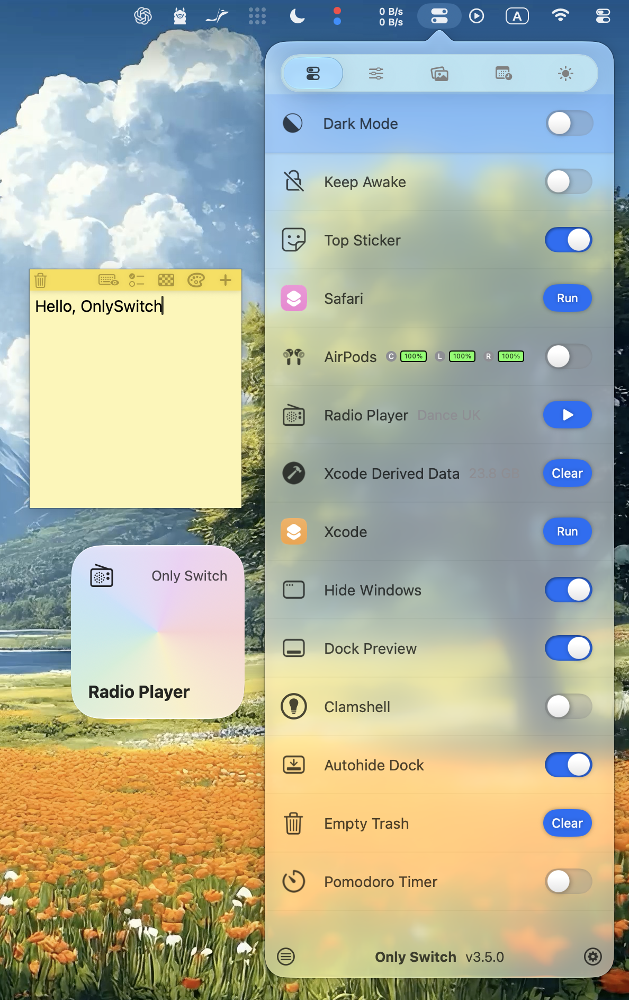
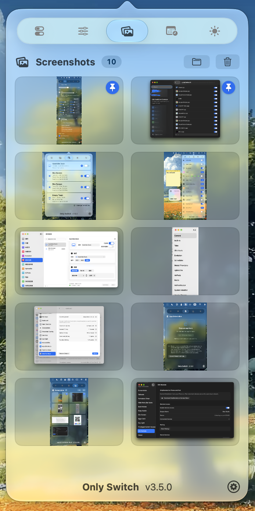
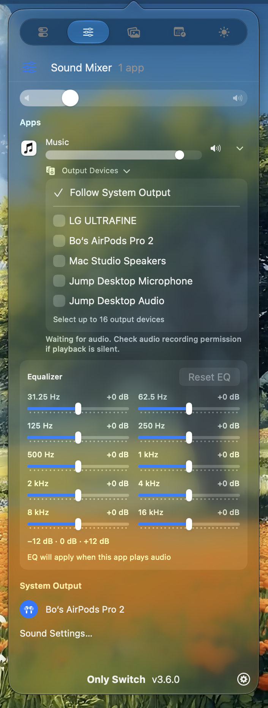
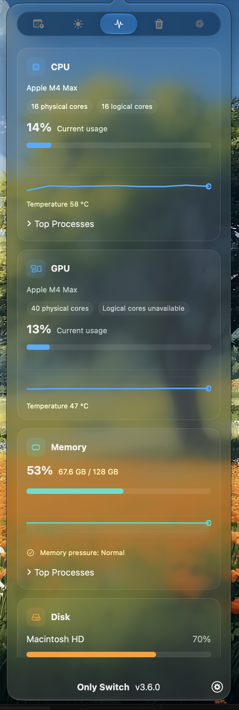
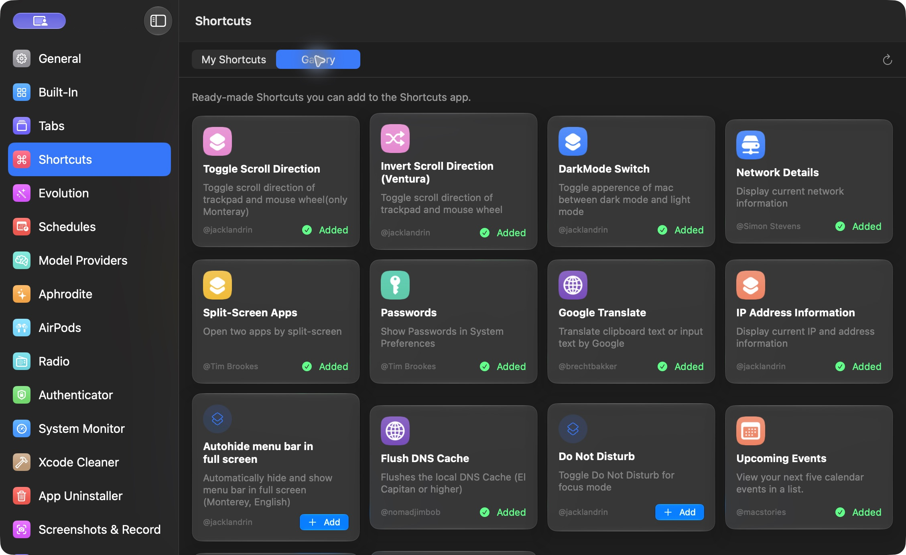
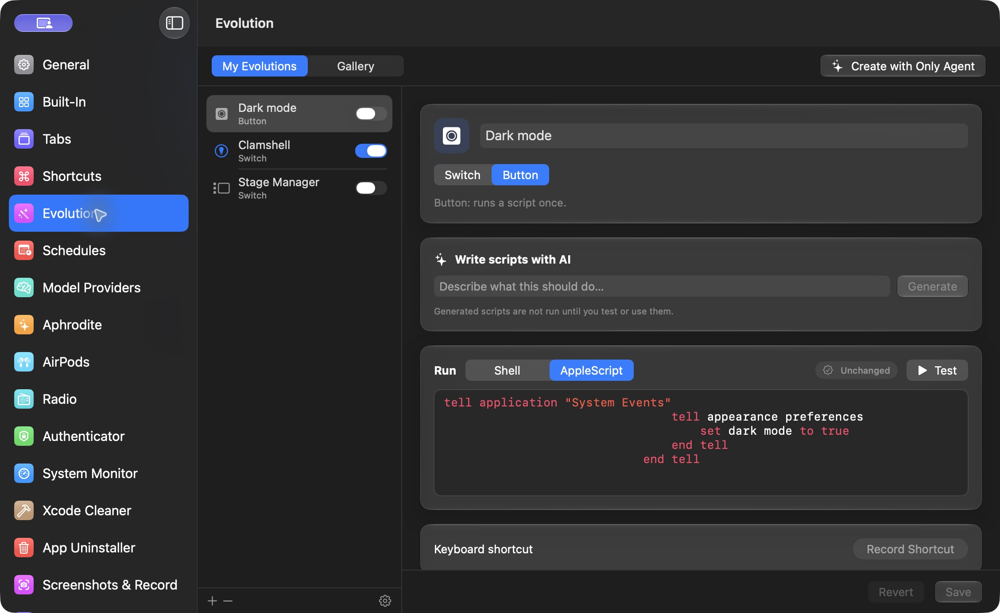
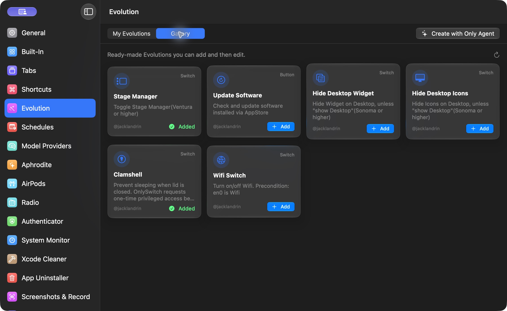
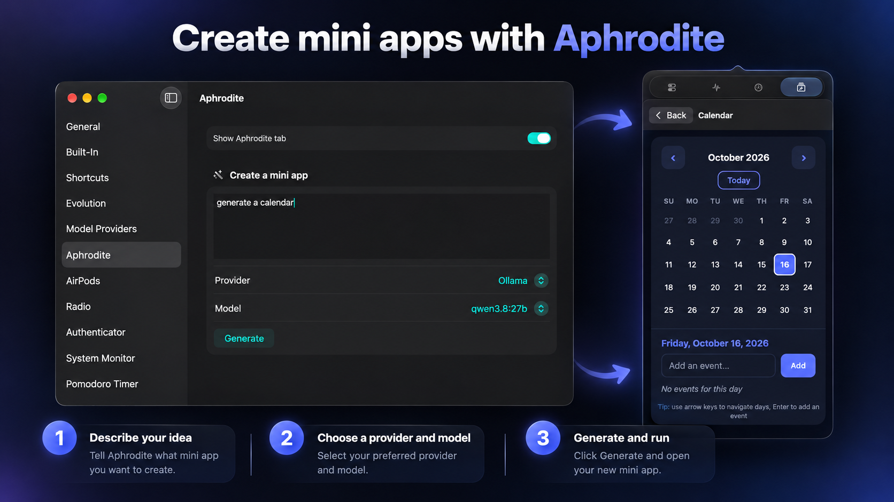
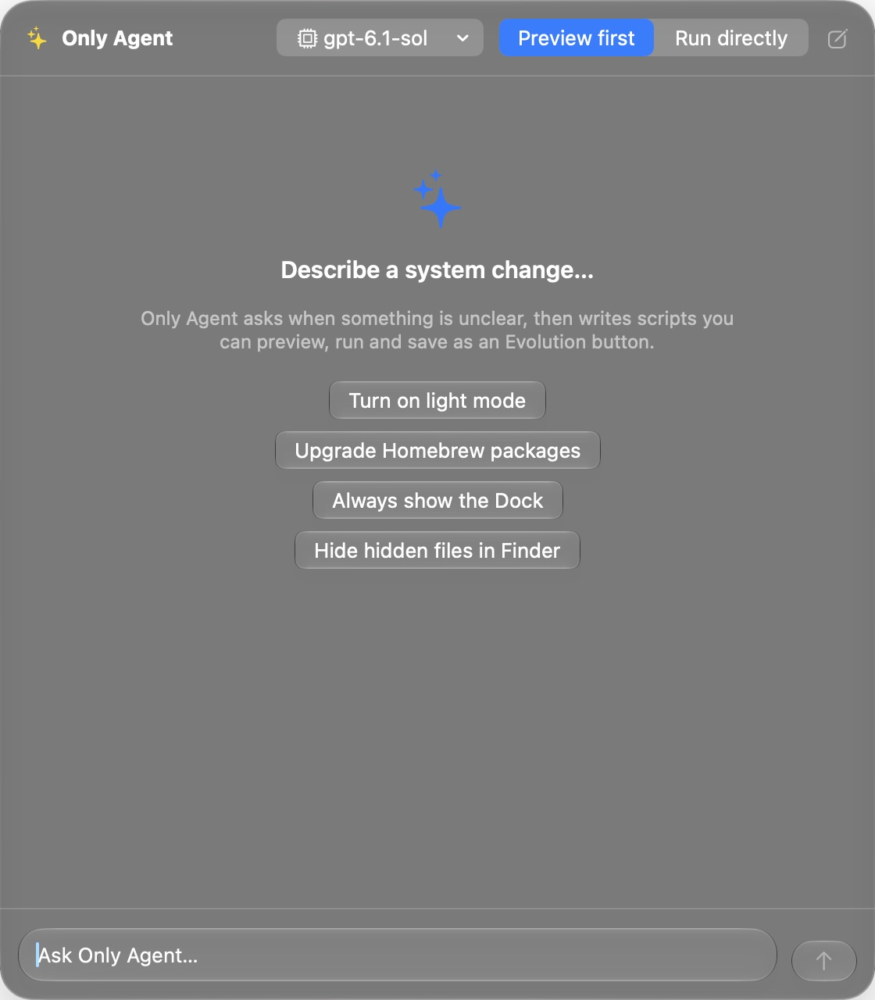

 
[](https://takoapi.com/agents/jacklandrin-onlyswitch)
 

<p align="center">
  <a href="https://onlyswitch.click">
    
  </a>
</p>

# OnlySwitch

[English](README.md) · [Deutsch](README.de.md) · **简体中文**

**一个多合一开关，让 Mac 菜单栏更清爽。**

OnlySwitch 将隐藏桌面图标、切换外观、防止 Mac 睡眠和隐藏刘海等常用 macOS 控件集中在一款可自定义的菜单栏应用中。你可以添加、移除或调整开关和快捷指令的顺序，为它们设置键盘快捷键，也可以通过小组件将控件放到桌面上。

<p align="center">
  
</p>

<table>
  <tr>
    <td valign="top" width="33%"></td>
    <td valign="top" width="33%"></td>
    <td valign="top" width="33%"></td>
  </tr>
</table>

## 安装

### Homebrew

```sh
brew install only-switch
```

### 手动下载

[下载最新版 OnlySwitch DMG](https://github.com/jacklandrin/OnlySwitch/releases/latest/download/OnlySwitch.dmg)。

> [!IMPORTANT]
> 2.5.6 及更早版本的自动更新功能无法正常工作。如果你正在使用这些版本，请手动更新，或通过 Homebrew 重新安装。

## 快速上手

1. 启动 OnlySwitch。如果菜单栏没有显示它的图标，请在 **系统设置 → 菜单栏** 中启用它。
2. 点击菜单栏中的 OnlySwitch 图标，打开控件列表。
3. 打开设置，添加、移除或调整开关及快捷指令的顺序，设置键盘快捷键，或启用可选功能。
4. 在支持的 macOS 版本上，从小组件图库中添加 Only Widget，即可在桌面或通知中心使用控件。

如需从 iPhone 或 iPad 控制 OnlySwitch，请[从 App Store 安装 OnlyRemote](https://apps.apple.com/us/app/onlyremote/id6793657946)，然后在 OnlySwitch 设置中打开 **iOS 远程**，启用局域网访问并配对设备。

<p align="center">
  
</p>

<p align="center">
  
</p>

## 功能

### 主要功能

- 使用[定时任务](#定时任务)自动执行 Mac 上的重复操作。
- 将 macOS 快捷指令导入 OnlySwitch，用键盘快捷键操作开关和快捷指令。
- 按自己的使用习惯选择和排列控件。内置开关按类别分组，也可以按名称搜索。
- 在 **OnlySwitch 设置 → 标签页** 中统一显示或隐藏菜单栏列表和 Only Control 中的可选标签页。
- 在 macOS Sonoma 及更新版本上使用 Apple 小组件，包括 Evolution 控件。
- 打开紧凑的 **Only Control** 控制面板，快速使用常用控件。
- 使用 [OnlyRemote](#onlyremote) 从 iPhone 或 iPad 控制 Mac。
- 启用可选的桌面宠物后，可将它拖到任意位置，点击它显示或关闭 Only Control，也可切换到下一首歌曲或下一个电台。Apple Music、Spotify 和电台播放时会显示相应动画。
- 为「防止锁屏」启用 **睡眠后关闭**，手动让 Mac 进入睡眠后，该功能会自动关闭。

<p align="center">
  
</p>

<p align="center">
  
</p>

### 定时任务

打开 **OnlySwitch 设置 → 定时任务**，即可自动执行受支持的开关、按钮、快捷指令和 Evolution 操作。你可以按固定间隔执行操作，在每小时的指定分钟执行，或在指定日期的固定时间执行。例如，每天 8:00 开启 **暗屏**、19:00 关闭，或每周六 9:00 执行 **清空废纸篓**。

在菜单栏或 Only Control 的 **定时任务** 标签页中，可查看下一项任务、立即执行操作，或启停某项计划。要显示或隐藏该标签页，请前往 **OnlySwitch 设置 → 标签页**。只要 OnlySwitch 仍在运行，即使没有打开窗口，定时任务也会在本机执行。

### 内置开关

| 开关 | 状态 | 开关 | 状态 |
|:---|:---|:---|:---|
| 隐藏桌面图标 | 已实现 | 藏刘海儿 | 有已知问题 |
| 深色模式 | 已实现 | 低电量模式 | 首次使用需要授权 |
| 屏幕保护程序 | 已实现 | 显示 Finder 路径栏 | 已实现 |
| 夜览 | 已实现 | 麦克风静音 | 已实现 |
| 自动隐藏程序坞 | 已实现 | 缩小启动台图标 | 已实现 |
| AirPods | 已实现 | 番茄钟 | 已实现 |
| 蓝牙 | 已实现 | 显示文件扩展名 | 已实现 |
| Xcode 缓存 | 已实现 | 显示用户资源库文件夹 | 已实现 |
| 自动隐藏菜单栏 | 已实现 | 静音 | 已实现 |
| 显示隐藏文件 | 已实现 | 清空剪贴板 | 已实现 |
| 网络电台 | 已实现 | 清空废纸篓 | 已实现 |
| 防止锁屏 | 已实现 | 在程序坞中显示最近使用的应用 | 已实现 |
| Spotify | 已实现 | Apple Music | 已实现 |
| 屏幕检测与清洁 | 已实现 | 隐藏菜单栏图标 | 部分实现 |
| FKey | 已实现 | 背景噪音 | 已实现 |
| 暗屏 | 已实现 | 推出磁盘 | 已实现 |
| 隐藏窗口 | 部分实现 | 原彩显示 | 已实现 |
| 置顶便笺 | 部分实现 | Key Light | 已实现 |
| Only Agent | 已实现 | 自然滚动 | 已实现 |
| 显示桌面宠物 | 已实现 | Tailscale | 需要官方客户端 |
| 程序坞预览 | 需要辅助功能与屏幕录制权限 | | |

你可以向列表添加开关，也可以将它们移除。要显示或隐藏可选标签页（身份验证器、音量混合器、亮度、截屏与录屏、系统监视器、Codex 使用情况、Claude 使用情况、Aphrodite、Xcode 清理和应用卸载器），请前往 **OnlySwitch 设置 → 标签页**。过去仅用于切换标签页的开关已由此页面取代。

### 音量混合器

音量混合器可分别调节正在播放声音的各个应用的音量和静音状态。在 macOS 14.4 或更新版本上，每个应用还可展开自己的 10 段均衡器（−12 至 +12 dB，可重置为平直响应），并将声音同时输出到一个或多个设备。均衡器设置和所选输出设备会按应用保存；未选择输出设备时，跟随系统默认设置。如果选中的设备全部断开，应用会恢复原先的音频输出，直到其中一个设备重新连接。

当前输出设备是带扬声器的外接显示器时，键盘上的音量加、音量减和静音键会通过 DDC/CI 调节显示器音量，并显示音量提示。按住 Shift+Option 可以进行更细的步进调节。要接管这些按键，需要辅助功能权限。

### 亮度

**亮度**标签页为每台正在使用的显示器提供一个滑块。OnlySwitch 对 Apple 显示器使用原生亮度控制，对兼容的外接显示器使用 DDC/CI；无法进行硬件控制时，则使用软件遮罩调暗画面。每行都会显示当前使用的方式。在 **OnlySwitch 设置 → 显示器** 中，可以启用平滑过渡、结合硬件和软件调光以进一步降低亮度、与内建显示器同步，也可以选择允许软件亮度降到零。

键盘上的亮度键会调节指针所在的外接显示器，支持与音量键相同的精细调节组合键。对内建显示器，macOS 的行为保持不变。软件调光改变的是画面亮度，而不是物理背光亮度。

### 截屏与录屏

**截屏与录屏**标签页将截图和屏幕录制集中在同一个列表。前往 **OnlySwitch 设置 → 截屏与录屏**，启用 **收集截屏与录屏**，即可将系统截图与 ⇧⌘5 录屏、iOS 模拟器的截图与录屏，以及 Xcode Device Hub 的截图与录屏保存到 `~/Pictures/OnlySwitch Screenshots`。OnlySwitch 会备份原有的捕捉设置，并在关闭收集时恢复。新捕捉的内容会以动画加入列表，录屏显示的是第一帧。

点击项目可复制，双击可打开，拖出列表可分享，也可将项目置顶。录屏会显示带时长的视频标记，复制时以文件形式复制。内置编辑器可在截图上添加笔迹、矩形、椭圆、箭头和模糊效果，并支持撤销和重做；保存时会按原格式覆盖原文件。录屏不支持编辑。删除会将文件移到废纸篓；**全部删除**会保留置顶项目。还可以在 **截屏与录屏**设置页为打开或关闭标签页设置快捷键。只复制到剪贴板的捕捉内容不会被收集。

### 程序坞预览

将指针悬停在程序坞中的应用上，即可查看其打开窗口的缩略图，点击缩略图可将窗口切换到前台。悬停在 Apple Music 或 Spotify 上时，还可使用上一首、播放或暂停、下一首控件。启用 **程序坞预览**开关，并在提示时授予辅助功能和屏幕录制权限。

### Tailscale

安装并设置 Tailscale 官方客户端后，前往 **OnlySwitch 设置 → Tailscale**，即可管理已保存的账户、出口节点和受支持的网络偏好设置。使用 **Tailscale** 开关可连接或断开当前账户；连接后，可通过副标题复制 Mac 的 Tailscale IP 地址。

### Xcode 清理

打开 **OnlySwitch 设置 → Xcode 清理**，也可在 **设置 → 标签页**中启用对应标签页，让它显示在菜单栏列表或 Only Control 中。扫描开发数据，检查选中的项目，再确认清理。支持的项目包括 DerivedData、Xcode 和 SwiftPM 缓存、模拟器缓存和日志、模拟器设备和运行时，以及 DeviceSupport 文件。扫描范围不包含源代码项目和归档。

### 应用卸载器

打开 **OnlySwitch 设置 → 应用卸载器**，也可在 **设置 → 标签页**中启用对应标签页，让它显示在菜单栏列表或 Only Control 中。拖入或选择应用，检查应用及匹配的相关文件，然后确认要移到废纸篓的项目。卸载器会在支持的位置按软件包标识符查找文件，结果可能不包含所有相关文件。

程序坞预览、Tailscale、Xcode 清理和应用卸载器只能在 Mac 本机使用，Only Widget 和 OnlyRemote 均不提供这些功能。Only Widget 不提供截屏与录屏功能；OnlyRemote Plus 可以查看、复制、拖拽和删除截图，也可以播放、拖拽和删除录屏，但不支持编辑。

### 快捷指令图库

打开 **OnlySwitch 设置 → 快捷指令 → 库**，可以浏览现成的 macOS 快捷指令，并将它们添加到「快捷指令」应用。在 **我的快捷指令**中，最多可选择 10 项显示在 OnlySwitch 菜单里，并为它们分配键盘快捷键。

<p align="center">
  
</p>

欢迎大家分享 macOS 快捷指令。请参阅[如何为快捷指令图库贡献内容](ShortcutsGalleryContributing.md)。

| 快捷指令 | 备注 | 快捷指令 | 备注 |
|---|---|---|:---|
| 切换滚动方向 | Monterey | 反转滚动方向（Ventura） | Ventura |
| 切换深色模式 | | 网络详情 | |
| 应用分屏 | | 密码 | |
| Google 翻译 | | IP 地址信息 | |
| 全屏时自动隐藏菜单栏 | Monterey | 清除 DNS 缓存 | |
| 勿扰模式 | Monterey 或更新版本 | 即将发生的日程 | |
| S-GPT | 搭配 S-GPT Encoder 使用，需要 OpenAI API 密钥 | S-GPT Encoder | |

### 快捷指令操作

| 操作 | 状态 |
|---|---|
| 获取墙纸图像 | 有已知问题 |
| 获取墙纸 URL | 已实现 |
| 检查是否为深色模式 | 已实现 |
| 设置深色模式 | 已实现 |

### Evolution

打开 **OnlySwitch 设置 → Evolution → 我的 Evolution**，即可使用 Shell 或 AppleScript 创建自定义开关和按钮。在侧边栏选择一个 Evolution，可以编辑和测试脚本，也可分配键盘快捷键。在 macOS 26 或更新版本上，配置 Only Agent 后，你可以描述自己的需求，让它起草脚本供你审阅。

Evolution 脚本使用 OnlySwitch 的权限在本机运行。保存或导入前，请先检查脚本，尤其是会执行 Shell 命令、发送 Apple 事件或进行特权操作的脚本。

<p align="center">
  
</p>

切换到 **库**可浏览现成的 Evolution。点击 **添加**，即可将它加入 **我的 Evolution**，以便查看和编辑。欢迎大家分享 Evolution；请参阅[如何为 Evolution 图库贡献内容](EvolutionGalleryContributing.md)。

<p align="center">
  
</p>

| Evolution | 备注 | Evolution | 备注 |
|---|---|---|:---|
| 台前调度 | | 更新软件 | 适用于通过 App Store 安装的软件 |
| 隐藏桌面小组件 | Sonoma | 隐藏桌面图标 | Sonoma |
| 合盖模式 | | Wi-Fi 开关 | |

#### 创建 Evolution

Evolution 支持两种类型：

1. **按钮**：按下 **执行**时执行脚本。
2. **开关**：包含四个可编辑字段：
   - **检查状态：** 在 OnlySwitch 列表打开或设置更改时运行。调试按钮可显示脚本输出。
   - **开启条件：** 定义表示已开启的脚本输出。
   - **开启：** 将状态改为开启。
   - **关闭：** 将状态改为关闭。

保存前，请点击 **测试**，验证新增或修改过的 **执行**、**开启**或 **关闭**脚本。

### Aphrodite

Aphrodite 可以根据自然语言创建小型应用。描述你的需求，选择已配置的 AI 服务商和模型，然后生成、运行、编辑、保存、分享或导入结果。Aphrodite 需要 macOS 26 或更新版本，并使用 OnlySwitch 中配置的模型服务商设置。

<p align="center">
  
</p>

### Only Agent 与 OpenClaw

Only Agent 是面向 macOS 26 或更新版本的对话助手。选择模型后，描述你想做的更改。Only Agent 可以提出后续问题，也能起草 Shell 或 AppleScript 脚本，供你运行或保存为 Evolution 按钮。选择 **先预览**可在运行前检查脚本，选择 **直接执行**则会立即执行。如果使用托管模型，你的提示词可能会发送给该模型的服务商。

<p align="center">
  
</p>

你也可以通过 [OpenClaw](https://openclaw.ai/) 用自然语言控制 OnlySwitch。例如，说出「清空废纸篓」「切换防止锁屏」或「开启深色模式」，即可通过深度链接触发对应开关。请参阅 [OpenClaw 设置说明](OpenClaw/README.md)，了解如何安装到额外的技能目录或 `~/.openclaw/skills`。

### 系统监视器

系统监视器实时显示 CPU、GPU、内存、磁盘和网络用量。在 Only Control 中打开对应标签页，再前往 **OnlySwitch 设置 → 系统监视器**选择仪表板卡片和可选的菜单栏指示器。展开 CPU 和内存卡片可以查看占用最高的进程。网络详情会显示 Wi-Fi 或以太网信息、本地和公网 IP 地址，以及 macOS 提供的 SSID、信号强度和链路速率。

即使关闭 Only Control 弹出面板，已启用的菜单栏指示器仍会继续采样，最短采样间隔为一秒。查询公网 IP 时会向 ipify 的 IPv4 和 IPv6 接口发送请求，结果最多缓存五分钟。

如果硬件或 macOS 未提供某些指标（如温度），应用就无法显示它们。GPU 指标依赖未公开的 macOS 私有 API，系统更新后可能失效。网络用量是整个系统的统计数据，不提供单个进程的网络速率。

如果某个进程关联到普通 macOS 应用，点击它在 CPU 或内存列表中的行即可激活该应用。受保护进程或仅在后台运行的进程可能无法激活。

### Codex 和 Claude 使用情况

**Codex 使用情况**是可选的内置标签页，显示已登录 Codex 账户的套餐、五小时和每周剩余额度、重置时间、可用点数及重置额度信息。它使用本机现有的 Codex 登录状态，无需在 OnlySwitch 中另行登录。

**Claude 使用情况**显示 Claude Code 账户的套餐，以及该账户报告的五小时、每周、特定模型及额外用量。它使用现有的 Claude Code 登录状态；如果凭据过期，请在 Claude Code 中重新登录。

在 **OnlySwitch 设置 → 标签页**中启用 **Codex 使用情况**或 **Claude 使用情况**，即可在 OnlySwitch 和 Only Control 中显示对应标签页。

### OnlyRemote

[OnlyRemote](https://apps.apple.com/us/app/onlyremote/id6793657946) 通过局域网从 iPhone 或 iPad 控制 OnlySwitch。打开 OnlySwitch 设置中的 **iOS 远程**，启用访问并配对设备。在 OnlyRemote 的 **设置 → 标签页**中选择要显示的页面。「控件」始终显示；系统监视器、Codex 使用情况、Claude 使用情况、音量混合器、亮度、截屏与录屏和 Aphrodite 都是可选标签页。

OnlyRemote Plus 可解锁 **音量混合器**（按应用调节音量、静音、均衡器和输出设备）、**亮度**（按显示器调节亮度）、**截屏与录屏**（查看、复制、拖拽和删除 Mac 截图，以及播放、拖拽和删除不超过 512 MB 的录屏）和 Aphrodite。音量混合器、亮度和截屏与录屏标签页要求 Mac 安装最新版 OnlySwitch；只有 Mac 上的 OnlySwitch 支持录屏时，录屏才会显示。如果 iPhone 或 iPad 找不到 Mac，两端应用都会显示设备发现错误。

### Only Widget

可以为 Only Widget 配置受支持的内置开关和按钮，并将小组件放在桌面或通知中心。点击小组件即可触发相应控件。小组件也支持 Evolution。


### 屏幕检测与清洁

屏幕检测以全屏显示纯色画面，方便检查坏点或清洁屏幕。使用左右方向键在黑、白、红、绿、蓝之间切换。

## 已知限制与故障排查

### OnlySwitch 崩溃报告

更新后的应用首次启动时，OnlySwitch 会开始监测新的崩溃报告。之后启动时，它会提示最新的一份尚未处理的报告。如果重新打开 OnlySwitch 时 macOS 还在写入报告，后续启动时仍可检测到它。若要在错误报告中附上 `.ips` 文件，请选择 **在访达中显示**，找到对应文件。OnlySwitch 不会上传该文件。

如果没有看到提示，请打开 **控制台 → 崩溃报告**，查找 **OnlySwitch**。查找旧报告或在 OnlySwitch 无法完成启动时，也可使用此方法。

### 菜单栏中找不到 OnlySwitch 图标

OnlySwitch 通过菜单栏图标打开。在 macOS 26.2 上，如果在系统的菜单栏设置中禁用了 OnlySwitch，它可能看起来没有启动。

1. 打开 **系统设置 → 菜单栏**。
2. 找到并启用 **OnlySwitch**。
3. 点击菜单栏中的 OnlySwitch 图标。

如果图标仍未出现，可能是其他项目占满了菜单栏。请移除或隐藏一些项目。如果你使用 OnlySwitch 的折叠功能，也请参阅[隐藏菜单栏图标](#隐藏菜单栏图标)。如果问题依旧，请在 [议题 #188](https://github.com/jacklandrin/OnlySwitch/issues/188) 中附上 macOS 版本、OnlySwitch 版本和菜单栏设置。

### 隐藏菜单栏图标

启用后，分隔图标（箭头）左侧的项目会被隐藏。按住 Command 并拖动菜单栏图标，即可调整隐藏区域。可以在设置中关闭此功能，或修改自动隐藏的间隔。如果日期显示不全，请前往 **系统设置 → 控制中心 → 时钟选项 → 显示日期 → 始终**。也可以右键点击此功能的图标进行控制。


在 macOS 27 或更新版本上，OnlySwitch 使用系统原生的菜单栏可见性机制。首次折叠时会请求辅助功能权限，以便让分隔图标右侧的图标保持可见。如果拒绝授权，或 macOS 更新导致此机制无法使用，菜单栏会保持原样，开关也会保持关闭。

macOS 27 上的这项集成依赖私有 API，不适合通过 Mac App Store 分发，也可能在 macOS 更新后失效。启用时，macOS 还会隐藏「正在播放」，并可能隐藏相机、隔空投送、专注模式和计时器；OnlySwitch 无法将这些系统项目排除在外。

在 macOS 27 上进行开发测试时，请从 `/Applications` 运行已签名的构建，而不是从 Xcode 的 `DerivedData` 目录运行。系统的可见性匹配机制可能无法识别从 DerivedData 启动的应用，从而隐藏 OnlySwitch 的图标。启动「应用程序」文件夹中的副本前，请先退出由 Xcode 启动的实例。

如果按住 Command 拖动分隔图标后，OnlySwitch 的两个图标都消失了，请前往 **系统设置 → 菜单栏 → 允许在菜单栏中显示**，重新启用 OnlySwitch。在 macOS 27 上，拖动旧版中不可移除的状态栏项目可能导致整个应用被禁用。当前版本已将两个 OnlySwitch 项目都设为可移除，以避免此问题。

### 藏刘海儿

「藏刘海儿」只会出现在搭载 M1 Pro 或 M1 Max 的 MacBook Pro 的内建显示器上。它只对当前桌面生效，不会同时改变所有空间。支持动态墙纸，但处理时间较长。

<p align="center">
  
</p>

### 低电量模式

低电量模式使用需要 root 权限的命令。OnlySwitch 会在首次使用时请求授权，以安装或授权特权辅助程序。只要授权仍然有效，之后切换就不会再次提示。

### AirPods 检测

OnlySwitch 通过 `classOfDevice` 的值 `2360344` 识别 AirPods Pro。其他代的 AirPods 可能报告不同的值。欢迎第 1 至第 3 代 AirPods 的用户提供反馈；电池数值的数量可能可以作为备用识别依据。

### 电台播放器

电台播放器支持 M3U 和 AAC 音频流。如果发生崩溃，请在报告中附上崩溃日志和音频流 URL。在电台设置中关闭声波效果后，会改用更稳定的 AVPlayer 播放方式。禁用电台功能会隐藏对应开关，并取消它在「正在播放」中的注册，但 macOS 可能会有短暂延迟。电台列表支持导出和导入。

### 更新后的小组件语言

从 2.5.0 版本更新后，可能需要重新设置应用语言。如果小组件没有使用所选语言，请退出 Only Widget 进程，让它重新加载设置。

## 开发

请先阅读 [ARCHITECTURE.md](ARCHITECTURE.md)，以了解项目边界和开发约束。

- `OnlySwitch/` 是 macOS 菜单栏主应用，负责应用专属界面、持久化、音频和系统集成。
- `OnlyWidget/` 是小组件扩展，使用可在扩展中安全运行的共享模型和副作用。
- `OnlySwitchRemote/` 是远程控制应用，共享协议约定，不引入主应用的实现细节。
- `Modules/` 是功能、领域模型、网络、远程通信和通用工具所在的主要 Swift Package 边界。
- `OpenClaw/` 包含基于深度链接的自然语言集成及其设置文档。

应用采用 The Composable Architecture，通过依赖注入执行副作用。请勿将业务逻辑放进 SwiftUI 视图，遵守 Swift 6 的并发安全要求，并将 Shell 命令、Apple 事件、钥匙串访问、网络、系统设置和用户权限作为明确且可测试的边界。

## 社区与贡献

欢迎加入 [Telegram 群组](https://t.me/OnlySwitchforMac)或 [Discord 服务器](https://discord.gg/UzSNpYdPZj)。

欢迎提交拉取请求，尤其是修复错误或补充翻译。如果有其他想法，可以创建议题或给维护者发邮件。

### 支持的语言

英语、简体中文、德语、克罗地亚语、土耳其语、波兰语、菲律宾语、荷兰语、意大利语、俄语、西班牙语、日语、索马里语、韩语、法语、乌克兰语、斯洛伐克语、巴西葡萄牙语和捷克语。

### 捐赠

如果 OnlySwitch 对你有帮助，欢迎[捐赠以支持项目开发](https://www.paypal.com/donate/?hosted_button_id=V3NDUXWZ6GVYG)。

### 媒体报道

| | | | |
|---|---|---|:---|
| [itopnews.de](https://www.itopnews.de/?s=OnlySwitch) | [Ifun.de](https://www.ifun.de/suche/OnlySwitch) | [appgefahren.de](https://www.appgefahren.de/onlyswitch-kleines-tool-mit-wichtigen-aktionen-fuer-die-mac-menueleiste-312135.html) | [CASCHYS BLOG](https://stadt-bremerhaven.de/only-switch-fuer-macos-schnellzugriff-auf-einige-systemoptionen/) |
| [softpedia](https://mac.softpedia.com/get/System-Utilities/OnlySwitch.shtml) | [macupdate](https://www.macupdate.com/app/mac/63719/onlyswitch) | [v1tx](https://www.v1tx.com/post/onlyswitch/) | [OSCHINA](https://www.oschina.net/p/onlyswitch) |
| [Macken](https://www.macken.xyz/2021/12/gratis-ar-gott-alla-installningar-pa-ett-stalle-onlyswitch/) | [AAPL Ch](https://applech2.com/archives/20220111-onlyswitch-all-in-one-status-bar-button-for-mac.html) | [appsofter](https://appsofter.com/download/1265.html) | [lifehacker.ru](https://lifehacker.ru/onlyswitch) |
| [appletechnikblog](https://appletechnikblog.com/de/2022/02/25/app-tipp-der-woche-only-switch-fuer-die-menueleiste-auf-dem-mac/) | [All-in-One person](https://en.blog.themarfa.name/how-to-quickly-manage-macos-system-settings/) | [Mac Gadget](https://www.macgadget.de/News/2022/03/24/OnlySwitch-Schnellzugriff-auf-viele-Systemfunktionen-per-Mac-Menueleiste) | [MaxiApple](https://www.maxiapple.com/2022/05/onlyswitch-macos-mac-gratuit.html) |
| [insmac](https://insmac.org/macosx/5018-onlyswitch.html) | [tchgdns](https://tchgdns.de/onlyswitch-macos-open-source/) | [insmac](https://insmac.org/macosx/5018-onlyswitch.html) | [macbff](https://macbff.com/onlyswitch-2-3-1/) |
| [korben](https://korben.info/controler-macos-onlyswitch.html) | [macg](https://www.macg.co/logiciels/2023/03/onlyswitch-ajoute-une-pelletee-de-raccourcis-pratiques-votre-barre-des-menus-135357) | [korben](https://korben.info/controler-macos-onlyswitch.html) | [AlternativeTo](https://alternativeto.net/software/only-switch) |
| [macsoft.jp](https://macsoft.jp/onlyswitch/) | [macgeneration](https://www.macg.co/logiciels/2023/03/onlyswitch-ajoute-une-pelletee-de-raccourcis-pratiques-votre-barre-des-menus-135357) | [hdwh.de](https://hdwh.de/onlyswitch-vereinfacht-eure-routinearbeit-mit-praktischen-schaltern/) | [MacKed](https://macked.app/onlyswitch.html) |
| [Mac Torrents](https://www.tntmactorrent.net/onlyswitch-for-mac-free-download/) | [PCtipp](https://www.pctipp.ch/praxis/mac/mac-tipp-onlyswitch-2-2892320.html) | [lifehacker](https://lifehacker.com/tech/change-hidden-mac-settings-with-onlyswitch) | [PHAPLUAT](https://kynguyenso.plo.vn/su-dung-onlyswitch-de-tuy-chinh-tat-ca-cai-dat-may-mac-nhanh-hon-post776151.html) |
| [Techgedöns](https://tchgdns.de/onlyswitch-menueleisten-multitool-bekommt-widgets-fuer-den-mac-desktop/) | [MacVince](https://www.youtube.com/watch?v=ARfBLKzRQY4&t=41s) | [onmymenubar](https://onmymenubar.app/onlyswitch/) | |

### 贡献者

#### 翻译

| 语言 | 贡献者 | 语言 | 贡献者 |
|---|---|:---|:---|
| 德语 | @C0d3Br3aker | 意大利语 | @bellaposa |
| 克罗地亚语 | @milotype | 俄语 | @kirillyakopov |
| 土耳其语 | @berkbatuhans | 西班牙语 | @kant |
| 波兰语 | @kpacholak | 日语 | @ShogoKoyama |
| 荷兰语 | Alex | 索马里语 | @abdorizak |
| 菲律宾语 | Rosel | 韩语 | @iosdevted |
| 法语 | @BtKent 和 Ange Lefrère | 乌克兰语 | @andryua |
| 斯洛伐克语 | @Svec-Tomas | 巴西葡萄牙语 | @EvertonCa |
| 捷克语 | @ForksApps | | |

另感谢：

- @wrngwrld 为电台播放器添加了音量滑块。
- @kant 修复了语法问题。
- @Ryderwe 贡献了身份验证器。
- @lou1s19 贡献了 Only Agent 对 Claude 模型的支持、音量混合器和外接显示器调暗功能。
- @oecer 贡献了设置备份功能。

## 致谢

- 夜览功能参考了 [Nocturnal](https://github.com/joshjon/nocturnal)。
- [LaunchAtLogin](https://github.com/sindresorhus/LaunchAtLogin).
- AirPods 电量功能参考了 [AirPods Battery Monitor For Mac OS](https://github.com/mohamed-arradi/AirpodsBattery-Monitor-For-Mac)。
- 动态墙纸处理参考了[这篇文章](https://itnext.io/macos-mojave-dynamic-wallpaper-fd26b0698223)和 [wallpapper](https://github.com/mczachurski/wallpapper)。
- [AlertToast](https://github.com/elai950/AlertToast).
- [AudioStreamer](https://github.com/syedhali/AudioStreamer)，修改后用于播放实时音频流。
- [AudioSpectrum](https://github.com/potato04/AudioSpectrum)，修改后适用于 AppKit。
- [Alamofire](https://github.com/Alamofire/Alamofire).
- 音效来自 [Mixkit](https://mixkit.co) 和 [Pixabay](https://pixabay.com)。
- [KeyboardShortcuts](https://github.com/sindresorhus/KeyboardShortcuts).
- Apple Music 和 Spotify 开关参考了 [SpotMenu](https://github.com/kmikiy/SpotMenu)。
- 隐藏菜单栏图标的设计灵感来自 [Hidden](https://github.com/dwarvesf/hidden)。
- FKey 参考了 [Fluor](https://github.com/Pyroh/Fluor)。
- 隐藏窗口功能参考了 [Later](https://github.com/alyssaxuu/later)。
- [The Composable Architecture](https://github.com/pointfreeco/swift-composable-architecture).
- [Sparkle](https://github.com/sparkle-project/Sparkle).
- 原彩显示功能参考了 [Shifty](https://github.com/thompsonate/Shifty)。
- [swift-markdown-ui](https://github.com/gonzalezreal/swift-markdown-ui).
- Key Light 参考了 [mac-brightnessctl](https://github.com/rakalex/mac-brightnessctl)。
- [AIProxySwift](https://github.com/lzell/AIProxySwift).
- [ollama-swift](https://github.com/mattt/ollama-swift).
- [CodexKit](https://github.com/timazed/CodexKit).
- Codex 使用情况功能的设计灵感来自 [CodexBar](https://github.com/steipete/CodexBar)。

## 许可证

OnlySwitch 采用 MIT 许可证。
